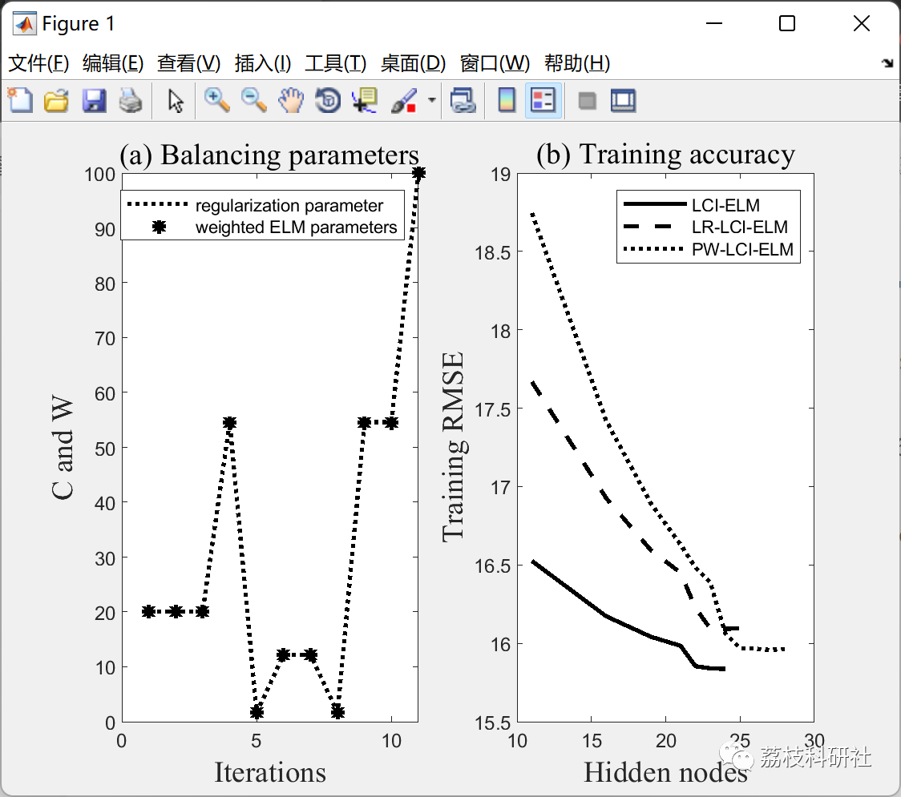
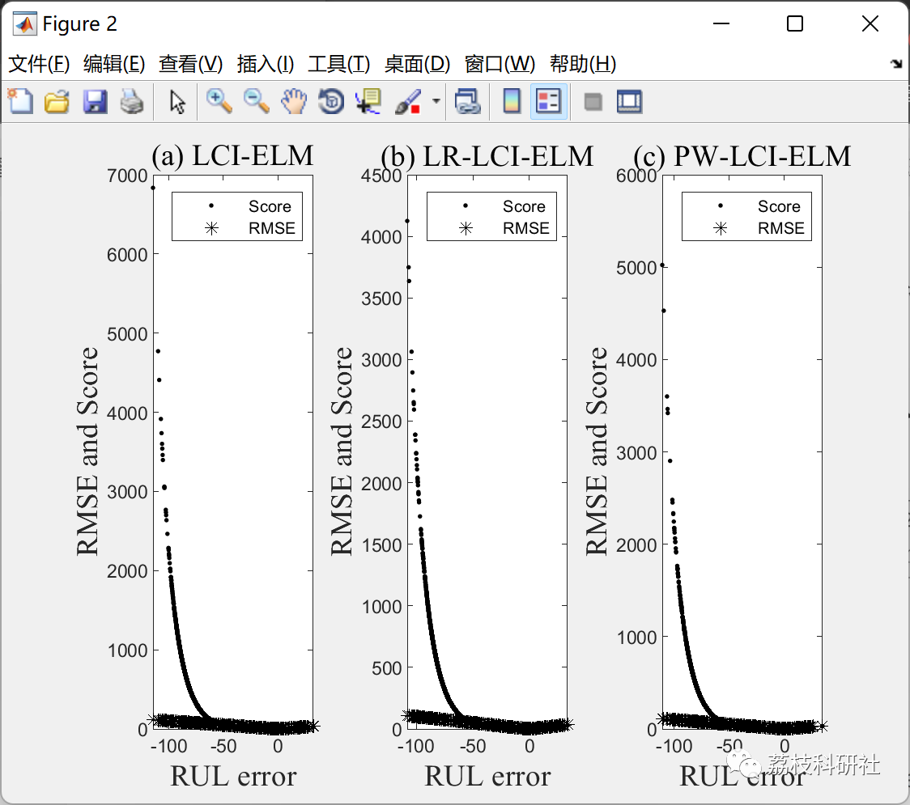

# Dynamically Adaptive Weighted Extreme RUL Prediction Based on Matlab Code

💥💥💞💞 Welcome to this blog❤️❤️ 💥💥
🏆 Bloggers' Advantages: 🌞🌞🌞 The content of the blog strives for rigorous thinking and clear logic to facilitate readers.
⛳️ Mantra: A journey of a thousand miles is begun with a single step.
Litchi Research Society
Code Collection: Electrical Systems, Intelligent Algorithms and Applications, Neural Network Prediction, Path Planning, Optimized Scheduling, Workshop Scheduling, Image Processing, Signal Processing...
🎁 Special Section Links:
🌈🌈🌈🌟🌟🌟🌟 Electrical Code Intelligent Algorithms and Their Applications Path Planning Neural Network Prediction Optimized Scheduling Image Processing Workshop Scheduling Signal Processing Romantic Her Thoughts Math Modeling Complete Code Issues
💥1 Overview
This article introduces the new improvement of LCI-ELM proposed in [1]. The innovation focuses on adapting the training model to higher-dimensional "time-varying" data. The proposed algorithm was studied using the C-MAPSS dataset[2]. PSO[3] and R-ELM[4] training rules were integrated together for this task.
[1] Y. X. Wu, D. Liu, and H. Jiang, "Length-Changeable Incremental Extreme Learning Machine," J. Comput. Sci. Technol., vol. 32, no. 3, pp. 630–643, 2017.
[2] A. Saxena, M. Ieee, K. Goebel, D. Simon, and N. Eklund, "Damage Propagation Modeling for Aircraft Engine Prognostics," Response, 2008.
[3] M. N. Alam, "Codes in MATLAB for Particle Swarm Optimization Codes in MATLAB for Particle Swarm Optimization," March 2016.
[4] J. Cao, K. Zhang, M. Luo, C. Yin, and X. Lai, "Extreme Learning Machine and Adaptive Sparse Representation for Image Classification," Neural Networks, vol. 81, no. 61773019, pp. 91–102, 2016.
📚2 Run Results
🎉3 References
[1] Y. X. Wu, D. Liu, and H. Jiang, "Length-Changeable Incremental Extreme Learning Machine," J. Comput. Sci. Technol., vol. 32, no. 3, pp. 630–643, 2017.
[2] A. Saxena, M. Ieee, K. Goebel, D. Simon, and N. Eklund, "Damage Propagation Modeling for Aircraft Engine Prognostics," Response, 2008.
[3] M. N. Alam, "Codes in MATLAB for Particle Swarm Optimization Codes in MATLAB for Particle Swarm Optimization," March 2016.
[4] J. Cao, K. Zhang, M. Luo, C. Yin, and X. Lai, "Extreme Learning Machine and Adaptive Sparse Representation for Image Classification," Neural Networks, vol. 81, no. 61773019, pp. 91–102, 2016.
🌈4 Matlab Code Implementation
Click the left bottom corner of this article to read more.

## Images

<!-- PAYMENT_BLOCK -->

## Get this dataset

- Payment link (Stripe): [Buy now](https://buy.stripe.com/3cs8yP7sY87d0vu9AB)
- Payment QR code: 

<!-- /PAYMENT_BLOCK -->
